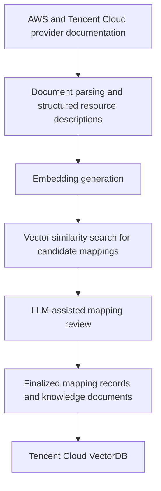
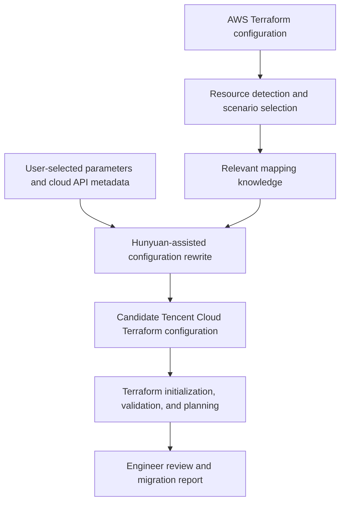

# Terraform Migration Assistant
### Retrieval-assisted infrastructure configuration conversion from AWS to Tencent Cloud

## Overview

Moving infrastructure between cloud providers requires more than renaming Terraform resources. Providers expose different resource models, parameters, dependencies, and service capabilities. A useful migration assistant must connect those differences to the configuration an engineer is trying to migrate.

This project combines **Tencent Hunyuan**, **Tencent Cloud VectorDB**, and **Terraform** to help translate AWS infrastructure configurations into Tencent Cloud configurations. It includes a resource-mapping knowledge pipeline and a web application for inspecting source configurations, generating candidate rewrites, and reviewing validation and planning feedback.

The result is an engineering prototype for assisted configuration migration. Generated code remains subject to human review and provider-specific checks.

## Two Connected Workflows

### 1. Build the Resource-Mapping Knowledge Base

The knowledge pipeline processes provider documentation, generates embeddings, retrieves candidate resource matches, and uses an LLM to review those matches. It then produces structured mappings and knowledge documents for retrieval.

LLM review is a mapping recommendation step, not proof that two cloud resources are behaviorally equivalent.

### 2. Assist Terraform Configuration Conversion

The application identifies resources in an uploaded Terraform file, selects migration scenarios, retrieves relevant knowledge, and generates a target configuration using Hunyuan. Parameter helpers query Tencent Cloud APIs for information such as available regions, zones, images, and instance types.

The code includes both scenario-specific and multi-scenario rewrite paths, along with browser-based configuration and migration interfaces.

## Implemented Components

| Component | What is present |
| --- | --- |
| Knowledge ingestion | Scripts for document synchronization, parsing, vectorization, matching, LLM review, mapping finalization, and ingestion |
| Mapping artifacts | Saved intermediate outputs for VPC and VPN-related categories, plus generated VPC knowledge documents |
| Migration application | FastAPI backend and browser UI for source upload, scenario analysis, and code rewriting |
| Retrieval integration | Scenario-aware knowledge search backed by Tencent Cloud VectorDB |
| Parameter assistance | Tencent Cloud API lookups and parameter templates |
| Terraform feedback | Code paths for initialization, validation, execution plans, and workspace management |
| Example infrastructure | Sample Terraform files and modules for VPC, security groups, CVM, and CLB |

These describe components visible in the implementation, rather than independently verified deployment results.

## Example Migration Scenarios

The current resource-detection configuration includes examples such as:

| AWS resource family | Intended Tencent Cloud target |
| --- | --- |
| EC2 instances | CVM instances |
| VPCs and related network configuration | Tencent Cloud VPC configuration |
| Subnets | Tencent Cloud subnets |
| Security groups and rules | Tencent Cloud security groups and rules |
| S3 buckets and bucket policies | COS configuration |

Scenario templates and mapping candidates do not imply complete coverage of every provider argument or service feature. The configuration also contains a database scenario, but it is not listed here as verified end-to-end migration support.

## Technical Highlights

- **Retrieval-augmented generation:** Supply resource-mapping context to the model before generating a rewrite.
- **Knowledge engineering:** Separate documentation processing and mapping generation from interactive migration requests.
- **Configuration-driven scenarios:** Keep resource detection, prompt routing, and parameter templates outside the main migration logic.
- **Cloud API integration:** Use deployment-specific metadata to help engineers select target parameters.
- **Infrastructure tooling:** Connect generated configuration to Terraform feedback instead of treating generated text as the final outcome.

**Stack:** Python, FastAPI, Tencent Hunyuan SDK, Tencent Cloud VectorDB, Tencent Cloud APIs, Terraform, and HTML/JavaScript.

## Implementation Layout

| Directory | Responsibility |
| --- | --- |
| `knowledgeBaseIngestion/` | Documentation processing, resource matching, knowledge generation, and vector database ingestion |
| `codeMigration/` | Web application, model and retrieval integration, prompts, examples, and Terraform tooling |
| `terraform_build_srcs/` | Example modular Tencent Cloud infrastructure configuration |

## Scope and Limitations

This project assists with **infrastructure configuration conversion**. It does not establish automatic migration of live workloads, application data, Terraform state, or production traffic.

- Generated mappings and code can be incomplete or incorrect, especially when provider semantics differ.
- Resource detection includes pattern matching; it should not be treated as a complete Terraform language parser.
- Passing `terraform validate` checks configuration validity, not functional equivalence or production readiness. A plan also requires review before any deployment.
- The prototype contains overlapping Terraform API route implementations that should be consolidated and tested before production use.
- No independently verified migration-success rate, accuracy benchmark, or production rollout result is reported here.

Further work could strengthen provider-version checks, regression tests, dependency preservation, and evaluation against reviewed migration examples.

## Showcase Scope

This document summarizes the project architecture and implementation. It does not include cloud credentials, private service endpoints, Terraform state, or full intermediate artifacts.

Any public release of the implementation should use sanitized examples and separately managed credentials. Cloud deployment and changes to live infrastructure require an explicitly reviewed workflow.
